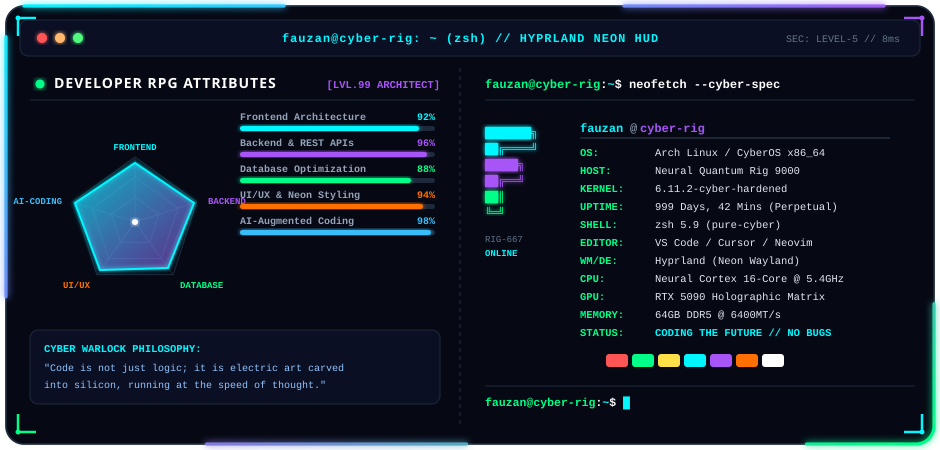

  

  

  
  
  

  

<!-- ========================================================================= -->
<!-- 01 CORE TECH STACK & ARSENAL                                              -->
<!-- ========================================================================= -->

  

  

<!-- ========================================================================= -->
<!-- 02 CELESTIAL NEON DRAGON CONTRIBUTION HARVESTER                           -->
<!-- ========================================================================= -->

  

  

<!-- ========================================================================= -->
<!-- 03 HOLOGRAPHIC RPG SKILL RADAR & SYSTEM TERMINAL                          -->
<!-- ========================================================================= -->

  

  

<!-- ========================================================================= -->
<!-- 04 DEVELOPER METRICS, STREAK & VELOCITY RIDGE                             -->
<!-- ========================================================================= -->

  

  

<!-- ========================================================================= -->
<!-- FOOTER                                                                    -->
<!-- ========================================================================= -->

  

